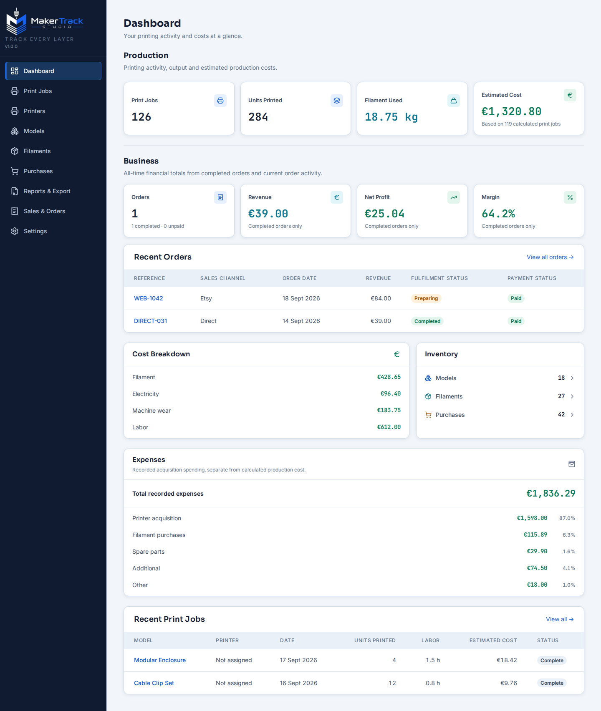
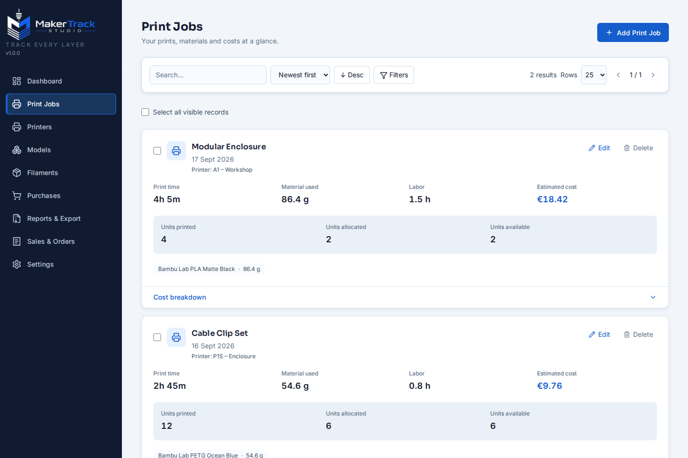
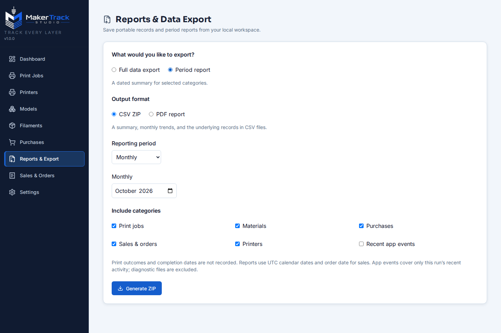
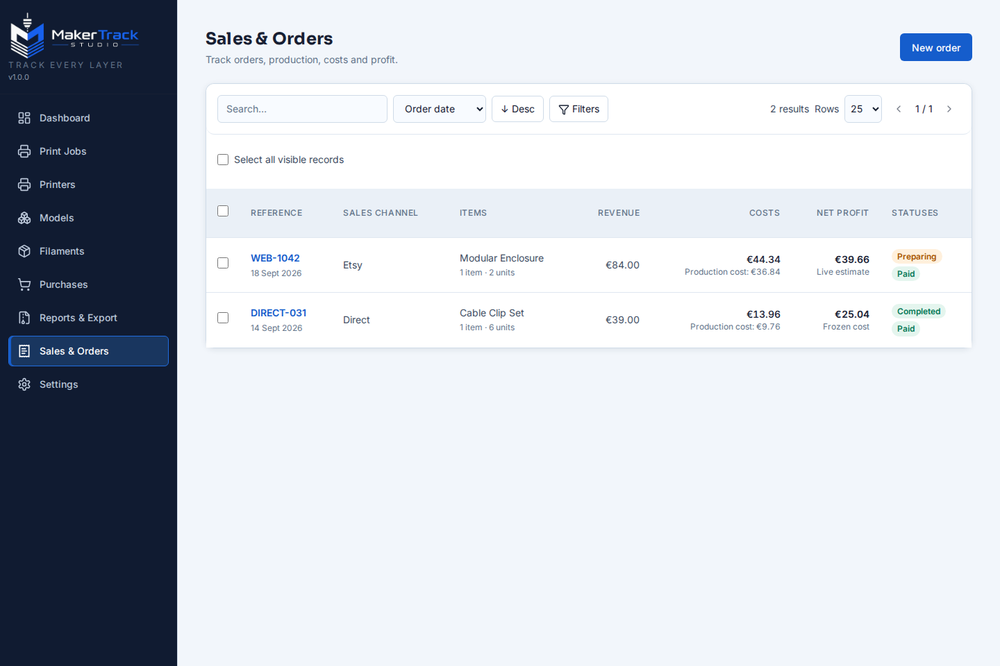

# Maker Track Studio

Maker Track Studio records 3D printers, materials, print jobs, purchases and
their costs. It is an offline-first desktop application with an optional,
LAN-only self-hosted browser distribution. Both modes use the same Go API,
React interface and SQLite data model.

## Features

- Track printers, filaments, models, jobs, purchases and production costs.
- Review period reports and export CSV, XLSX and PDF summaries.
- Export and restore portable ZIP backups.
- Enable the optional Sales & Orders workflow in Settings.
- Use the interface in English or Portuguese (Portugal).

## Screenshots

The screenshots use synthetic, deterministic fixtures.






## Supported distributions

### Desktop — Windows and Linux

The Wails desktop app runs the API on loopback and stores one SQLite database
per installation. See the [Desktop installation guide](apps/desktop/README-DISTRIBUTION.md)
for Windows x64 and Linux x64 installation, backup, update and recovery steps.
`v1.0.0` is published. Download installers and archives from the official
[GitHub Releases](https://github.com/GabrielAlmd/maker-track-studio/releases).
The next patch, `v1.0.1`, is in preparation.
See [release qualification](docs/PUBLIC_RELEASE.md) for the publication gates.

### Self-Hosted — Raspberry Pi and Linux

The optional browser edition runs on Linux ARM64 (including 64-bit Raspberry Pi
OS); Linux AMD64 is also supported. One server installation owns one persistent
SQLite database shared by browsers on the home LAN. Access is protected by an
HTTPS reverse proxy and a shared login. The API is not published directly.

Follow the [Self-Hosted installation and recovery guide](docs/SELF_HOSTED.md).
Do not expose it to the public Internet or configure router port forwarding.
Use only an image tag or digest published by the project. Check the release
notes for its matching image; do not assume a pending v1.0.1 image exists.

## Build from source

For the project map, setup, common change paths, and contributor references, see
the [developer wiki](docs/README.md).

Requirements: Go version from `apps/api/go.mod`, Node 24, a C compiler for
SQLite, and (on Linux desktop) GTK 3 and WebKitGTK 4.1 development packages.

```sh
cd apps/web
npm ci
npm run lint
npm test
npm run build

cd ../api
go test ./...
go vet ./...

cd ../desktop
go run github.com/wailsapp/wails/v2/cmd/wails@v2.12.0 dev -tags webkit2_41
```

On Windows, omit `-tags webkit2_41`. Desktop packaging instructions are in
[`apps/desktop/README.md`](apps/desktop/README.md). The self-hosted Compose
distribution can be built from `deployments/self-hosted` with Docker Buildx;
see its [deployment guide](docs/SELF_HOSTED.md).

## Local data and backups

Desktop data stays on the computer running the app. The default database path
is `~/.local/share/3d-printing-cost-tracker/app.db` on Linux and
`%USERPROFILE%/AppData/Roaming/3d-printing-cost-tracker/app.db` on Windows;
`SQLITE_PATH` can override it. Self-Hosted data stays in its server-side
persistent volume. The two installations do not synchronize. Transfer data
explicitly using the app's ZIP backup export and import, and retain a separate
copy before upgrades or migrations.

CSV and XLSX imports are available under **Settings > Data Migration**. See
[migration guidance](docs/DATA_MIGRATION.md) and
[SQLite recovery](docs/SQLITE_RECOVERY.md).

## Release readiness

- `v1.0.0` is published; this branch prepares the `v1.0.1` patch.
- See the [draft patch notes](docs/RELEASE_NOTES_1.0.1.md) and
  [readiness record](docs/RELEASE_READINESS_1.0.1.md).
- The self-hosted service is for trusted home LANs only, with no Internet access
  or automatic Desktop/server synchronization.
- Release qualification evidence must be completed for the exact source and
  artifacts before publication.
- Review [known limitations and release gates](docs/PUBLIC_RELEASE.md) before
  building or distributing binaries.
- Follow the [release roadmap](docs/ROADMAP.md) for remaining qualification work.

## Contributing

Read [CONTRIBUTING.md](CONTRIBUTING.md) for development checks, contribution
scope and first-issue guidance. Report vulnerabilities privately as described in
[SECURITY.md](SECURITY.md). The project follows the
[Code of Conduct](CODE_OF_CONDUCT.md).

## License

Maker Track Studio is available under the [MIT License](LICENSE). The included
Inter, Sora and JetBrains Mono fonts use SIL OFL 1.1; their notices are in
[`THIRD_PARTY_FONTS_OFL-1.1.txt`](THIRD_PARTY_FONTS_OFL-1.1.txt).
