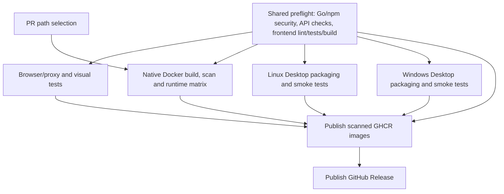

# CI execution and runner policy

## Execution order

The main workflow is `Desktop CI and Release`. Its PR selector runs alongside
shared preflight; new pushes cancel the preceding run of the same PR.



Preflight runs Go/npm security checks once, alongside API vet/tests and frontend
lint/unit/build checks. Native packaging remains limited to PRs into `main`,
version tags and manual packaging runs. Docker runs for relevant PRs into
`develop`/`main` and upstream version tags. Docs-only PRs avoid the Docker matrix.
The same path rules and depth-2 whole-PR comparison remain in effect.

Heavy jobs start after successful preflight and run in parallel. Both publishers
explicitly require their dependencies to succeed: a failed, skipped or cancelled
required check cannot authorize publication. In particular, GHCR publication now
also waits for browser tests and the Linux/Windows packages. No deployment to
user devices occurs in these workflows.

Manual `Self-hosted native validation` owns its preflight and then starts browser
and native container checks. Calls from the main workflow use its already
completed preflight. The former `upload-frontend` workflow input is removed.

## Frontend artifact

Preflight produces separate `web-frontend` and `desktop-frontend` artifacts,
retained for one day. Browser checks consume the explicit web build; native
packaging consumes the desktop build generated by `build-frontend.mjs`, with
`VITE_RUNTIME_MODE=desktop`. Native builds skip rebuilding these assets.
Never share the web build with desktop packaging: its API uses the proxy path
`/api` instead of the desktop loopback service.

The visual job sets `MAKER_TRACK_PREBUILT_WEB=1`. This serves `dist` directly and
requires `dist/index.html`; missing artifacts fail rather than triggering a
fallback build. Without the flag, local screenshot commands build normally.
Docker images retain their self-contained frontend build and native build caches.

## Failure policy and runners

| Execution | Matrix failure policy | Subsequent jobs |
| --- | --- | --- |
| Pull request | Cancel sibling Go/container matrix jobs on failure | Failed preflight prevents heavy jobs; failure of any required heavy check blocks publication |
| Tag, manual or scheduled scan | Finish matrix targets to collect diagnostics | Publication requires every required target to succeed |

An API scan failure skips the Desktop scan in the same PR job. Non-PR scans
continue to collect Desktop findings when the scanner itself was installed
successfully. Report uploads and cleanup retain their failure/cancellation
conditions; uploads from cancelled jobs are best effort. Independent job families
already running may finish; there is no global first-failure cancellation.

The npm audit and PR selector use `ubuntu-slim` (10/5-minute timeouts). Go source
analysis, frontend builds, browsers, Docker runtime tests and native packaging
keep their full Linux AMD64/ARM64 or Windows runners. Release packaging retains
its full runner until hosted artifact sizes/timings justify downsizing.

## Measurement and validation

No public baseline has been collected for these workflow optimizations. Compare
the same PR/tag coverage with cold and warm caches, recording total wall time,
sum of job durations and time spent after the first failure. For each run:

```sh
gh run view RUN_ID --json jobs
```

Local checks cover workflow syntax, prebuilt/missing/default screenshot config,
the full-PR path selector, real proxy/browser operation and the visual catalogue.
Native Windows/ARM64 scheduling and matrix cancellation require hosted CI.
Security policy and current image blockers are documented in
[Dependency Security](DEPENDENCY_SECURITY.md).
