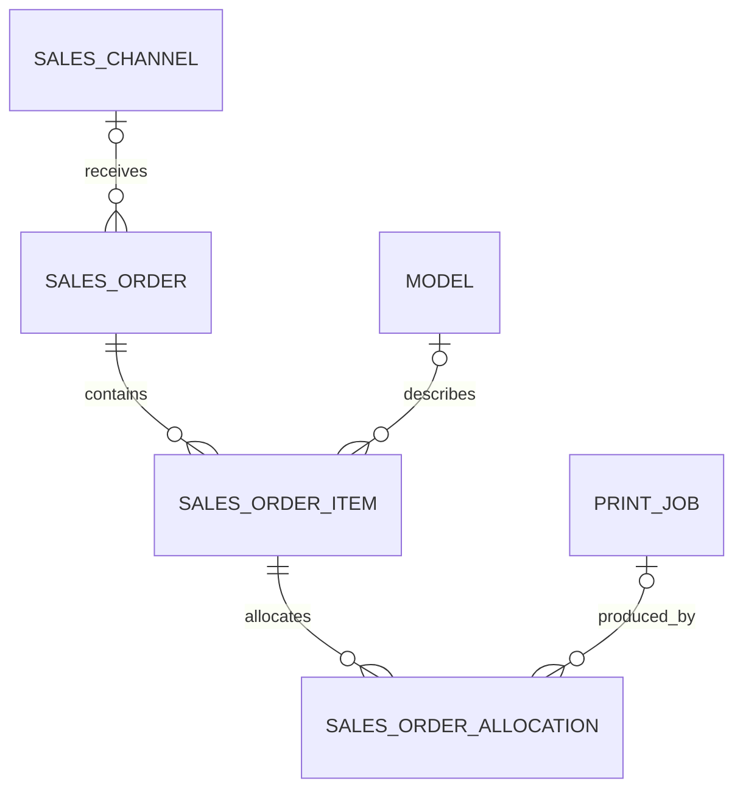

# Sales and Orders — allocations and profitability

## Purpose

Sales and Orders records what was sold, for how much, and how an order relates
to the existing production-cost domain. Production records such as Models and
Print Jobs continue to describe what was designed and manufactured. Sales
records add commercial history, consume the existing Print Job cost engine for
live profitability, and freeze the relevant production costs at completion.

The desktop app ships Sales & Orders as a built-in module. Its transactional
Sales and allocation routes are registered by the module; its pages, allocation
controls, and Business Dashboard metrics appear when the feature is enabled.
Inventory planning, invoices, marketplace integrations, and multi-currency
support remain outside this scope.

For the module contract and instructions for adding another module, see
[Desktop module architecture](MODULE_ARCHITECTURE.md).

## Entities

### `SalesOrder`

Represents one sale or customer order. It stores a human-readable reference,
order date, optional Sales Channel, fulfilment and payment states, integer-cent
packaging/shipping/platform/other costs, optional notes, and timestamps. When
completed, it also stores the production cost, total cost, net profit, and
margin snapshots required for stable historical profitability.

### `SalesOrderItem`

Represents a line within an order. Each item belongs to one Sales Order and
records the quantity, unit selling price in cents, an optional live Model link,
and the Model name captured when the item was created.

Several items may belong to one order. Quantity supports selling multiple units
of the same Model, and separate items allow several different Models in an
order.

### `SalesChannel`

Identifies where an order was received, such as a direct sale or marketplace.
It stores a name, optional notes, archive state, and timestamps. Archiving a
channel does not invalidate or remove historical orders. Platform fees are
stored on orders; channels do not calculate them automatically.

### `SalesOrderAllocation`

Links a positive number of units from one Sales Order Item to the Print Job that
produced them. One item can use several Print Jobs, and one Print Job can supply
several orders. At completion, each allocation also stores its proportional
`production_cost_cents` snapshot for traceability.

## Relationships



Sales Channel and Model links remain nullable. The Model name snapshot remains
available after the live Model link is cleared. Although the allocation's
database foreign key remains nullable for compatibility, the API requires a
live Print Job when creating an allocation and protects referenced Print Jobs
from deletion.

Sales Order Items are owned by their Sales Order, and allocations are owned by
their Sales Order Item. Deleting an order cascades to its items and allocations;
only draft orders can be deleted through the API. These ownership cascades do
not delete Models, Print Jobs, or Sales Channels.

Quantities and allocated units must be positive. Persisted Sales costs must be
nonnegative.

## Allocation API and rules

The allocation workflow extends the transactional Sales API:

- `GET /sales-orders/:id/allocations` returns an order's item allocations and
  item availability.
- `PUT /sales-orders/:id/allocations` atomically replaces the order's complete
  allocation set. An empty array removes all allocations while it is editable.
- `GET /print-jobs/:id/allocations` returns `units_printed`, active
  `units_allocated`, `units_available`, and structured `used_by` order data.

Order-level replacement keeps validation and mutation in one transaction.
Allocation writes take SQLite's writer lock before reading capacity, serializing
competing requests so two valid-looking writes cannot commit an over-allocation.

Every allocation must satisfy all of the following:

- the Order Item belongs to the order being changed;
- the Print Job exists;
- `PrintJob.ModelID` equals `SalesOrderItem.ModelID`;
- allocated units are positive;
- active allocations for an item do not exceed its ordered quantity;
- active allocations for a Print Job do not exceed `units_printed`.

An item with quantity 5 can, for example, use allocations of 2, 2, and 1 units
from three matching Print Jobs. A sixth unit is rejected.

An **active allocation** belongs to an order whose fulfilment status is not
`cancelled`. Cancelled orders retain allocation history but immediately stop
consuming Print Job capacity:

```text
units_available = units_printed - active_allocated_units
```

If a 10-unit Print Job supplies 3 units to one active order and 4 to another,
it reports 7 allocated and 3 available. Cancelling the first order changes the
active values to 4 allocated and 6 available without deleting its allocation.

Draft, confirmed, preparing, ready-to-ship, and shipped orders may replace
allocations. Completed and cancelled orders reject changes with `409 Conflict`.

## Live production cost and profitability

Orders that are not completed reuse the existing Print Job cost engine. Each
allocation receives a proportional share of its Print Job's total cost, rounded
to integer cents:

```text
Print Job:          10 units, €20 total production cost
Order allocation:   3 units
Allocated cost:     €20 / 10 × 3 = €6
```

Allocation costs are summed across every item and Print Job in the order. A
calculated zero remains a valid zero. If any referenced Print Job cost cannot be
resolved, production cost and dependent profitability values are `null` with a
`not_calculated` state and reason; unavailable cost is never reported as zero.

Profitability uses checked integer-cent arithmetic:

```text
Revenue = sum(item.quantity × item.unit_price_cents)

Additional costs = packaging
                 + shipping
                 + platform fee
                 + other costs

Total cost = production cost + additional costs
Net profit = revenue - total cost
Margin (%) = net profit / revenue × 100
```

Margin is unavailable when revenue is zero, preventing `NaN` or infinite JSON
values.

## Lifecycle states

Fulfilment states:

- `draft`
- `confirmed`
- `preparing`
- `ready_to_ship`
- `shipped`
- `completed`
- `cancelled`

Payment states:

- `unpaid`
- `paid`
- `refunded`

Payment changes remain independent of fulfilment changes. Partial payments are
not represented.

## Desktop workflow

Sales & Orders is disabled by default. Enable it in **Settings > Features** to
show the Sales navigation, Business Dashboard content, and Print Job allocation
capacity. Disabling the feature hides those presentation surfaces without
deleting Orders, Channels, allocations, or frozen snapshots. Its routes remain
registered in a build that includes the module, so existing deep links and API
calls continue to work.

The new Order form supports multiple Items, additional costs, and production
allocations. A Sales Channel is optional: **No sales channel** is a valid saved
state, including for imported or historical Orders. **Add Sales Channel** opens
a small inline modal; after a successful create, the new active Channel is
selected. Archived Channels cannot be assigned to new Orders, while an existing
draft Order may retain its already archived Channel.

Selecting a Model loads compatible Print Jobs newest-first. When the latest
compatible job has a calculated tier-1 suggested price, the form derives a unit
default by dividing that suggestion by the job's printed units. The result is
rounded to cents and remains editable. An unavailable calculation leaves the
price for the user to enter; it is never silently treated as zero.

Active Orders expose capacity-aware allocation inputs and lifecycle actions.
Completed Orders render as locked historical records with their frozen
profitability. Payment status, including `refunded`, remains independently
updateable as described above.

The order lifecycle treats `completed` and `cancelled` as
terminal. Reopening is therefore not added. A completed order's commercial
fields and items cannot be edited, and it cannot be deleted, moved to another
fulfilment state, or have its allocations replaced. Payment status remains
independently updateable. No path silently refreshes its frozen snapshot.

Deleting an unreferenced Print Job remains idempotent and returns `204 No
Content`. If any allocation references it—including a cancelled or completed
historical allocation—deletion returns `409 Conflict`. The reference check and
deletion take SQLite's writer lock so a concurrent allocation cannot race with
deletion. Allocations are neither cascaded nor silently nulled by the API.

## Money representation

All newly persisted Sales amounts use signed 64-bit integer minor units. For the
EUR-only Sales domain, the minor unit is one cent:

- `€12.99` is stored as `1299`.
- `€4.50` is stored as `450`.

Persisted fields include item prices, additional order costs, allocation and
order production costs, total cost, and net profit. Margin is frozen as integer
basis points. Sales money never uses floating-point storage; the existing Print
Job cost engine remains unchanged.

## Completion transaction and historical snapshots

`model_name_snapshot` preserves what was sold if a live Model is renamed or
deleted. Production and profitability use a separate snapshot created by the
transition to `completed` through `PUT /sales-orders/:id/status`.

In one SQLite transaction, completion:

1. takes the Sales writer lock and reloads the order, items, allocations, Print
   Jobs, Models, filaments, and cost dependencies;
2. revalidates references, Model matching, item capacity, and active Print Job
   capacity;
3. resolves every allocated Print Job through the existing cost engine;
4. writes each allocation's `production_cost_cents`;
5. writes the order's `production_cost_cents`, `total_cost_cents`,
   `net_profit_cents`, and `margin_basis_points`; and
6. changes fulfilment status to `completed` and commits.

If validation, cost resolution, or any write fails, all changes roll back and
the order keeps its previous status. Completion does **not** require every
ordered unit to be allocated. Existing allocations must be valid and their
costs resolvable; an order with no allocations has production cost zero.

Revenue and additional costs remain reproducible from the immutable completed
order and its items, so they are not duplicated. Completed reads use only the
frozen Sales values. Changes to printer configuration, filament prices, Models,
Print Job inputs, or current cost configuration cannot change history.

A legacy completed order without snapshot values returns `not_calculated`; it
is never recalculated from current production data.

## Migration

Desktop startup migrates core tables first, then the four Sales entities through
the installed Sales module in one SQLite transaction. The migration keeps the
existing table names and additively creates nullable snapshot columns. Its
`sales_orders` version is recorded in `module_versions` in the same transaction.
If a module migration fails, that transaction rolls back and startup fails.
Existing tables, IDs, and rows are retained; old completed rows receive null
snapshots rather than invented historical costs. A database with Sales tables
cannot be opened by a build that does not include the Sales module.

Every Sales entity uses the same Go `BeforeCreate`/`ensureUUID` convention as
existing persistent models. No database UUID extension or second UUID mechanism
is introduced.

## Backup compatibility

Desktop exports remain backup schema version 4. The archive contains a SQLite
snapshot, so the persisted Sales columns and `module_versions` are included.
Completed profitability restores exactly. No manifest-version bump is required.

This build accepts schema versions 1 through 4. Versions 1–3 predate Sales and
restore supported production data with empty Sales collections. Earlier
version-4 backups may contain the four Sales tables without snapshot columns;
they continue to import with null snapshots. Current version-4 backups preserve
both order-level and allocation-level cost snapshots. Backups made before
`module_versions` existed remain supported.

Schema-4 imports require all four Sales tables and validate Sales relationships,
identifiers, lifecycle states, quantities, and monetary ranges before replacing
target data. Invalid content is rejected rather than dropped. Deletion runs
from children to parents and recreation from parents to children; any write
failure rolls back the import transaction.

Import checks the backup and target database for module compatibility before
replacing data. It rejects an unavailable Sales module or a module version newer
than the build supports. Sales validation and restoration run through the module
hooks inside the existing import transaction.

Export a backup before upgrading. Older builds should use backups produced by
those builds rather than editing a newer archive's manifest.

## Out of scope

This workflow does not add advanced inventory or raw-material reservation,
printer scheduling, automatic platform-fee rules, customer CRM, invoices,
VAT/tax accounting, multi-currency, returns/restocking, partial-payment
accounting, or marketplace integrations.
