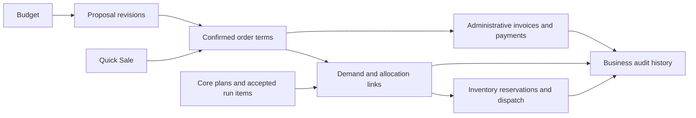

# BUS-01: Business Operations workflow and integration contract

Status: proposed implementation contract for issue #19, based on `develop`
`dcacdbe`. Target: v1.1.0 with epics #7 and #8. This architecture change adds
documentation and test-only examples, not runtime behavior, tables or migrations.
Review and merge of this contract is the architecture gate for the child issues.

## Scope and dependencies

On 2026-11-17 GitHub's native blocked-by list for #19 was empty. INV-01 (#9)
was closed with its specification and executable examples integrated by PR #36.
This document resolves that specification's Business handoff questions.
INV-04 (#12) is an open implementation issue after #11, not a prerequisite to
writing this contract. It must implement the Inventory boundary below; #16 adds
finished goods before #26 enables commercial stock operations. No ledger
implementation is claimed here.

Read this with [INV-01](PRODUCTION_V1_1.md), the
[current Sales contract](../SALES_AND_ORDERS.md) and
[module architecture](../MODULE_ARCHITECTURE.md). Keep the internal module ID and
feature preference `sales_orders`; the user-facing rename happens in #25.
Inventory and production remain core functionality when Business is hidden or
absent. Both epics must pass joint integration and packaged-runtime qualification
before release.

## Verified current behavior and gaps

| Source | Current behavior and implication |
| --- | --- |
| `modules/sales/storage/sales_order.go` | Order reference/date, optional channel, seven combined fulfilment states, three payment labels, integer-cent extra costs and nullable frozen financial snapshots. No customer, proposal or invoice records. |
| `storage/sales_order_item.go` | Stable UUID, quantity, unit price, nullable Model and name snapshot. The current create API requires a live Model even though historical links can be null. |
| `storage/sales_order_allocation.go` | UUID and item/job references, units and nullable frozen cost; no run-item or Inventory reference. |
| `storage/sales_channel.go` | Optional archived channel preserves order history; not a customer or a fee engine. |
| `handlers/sales_order_service.go` | Draft updates delete/recreate items and allocations. Confirmed commercial edits are rejected; status/payment updates are separate. |
| `handlers/sales_allocation_service.go` | SQLite writer lock protects job/model capacity; full replacement recreates allocations. Cancelled orders release active capacity but keep references. |
| `handlers/sales_completion_service.go`, `sales_profitability.go` | Atomic completion freezes allocation/order costs using the core calculator. Full allocation is not required; no allocations means zero cost. Missing historical snapshots remain unavailable. |
| `modules/sales/api/dto.go`, web `modules/sales/services/salesService.js` | Existing unversioned Sales endpoints and DTOs are shared with the current UI. |
| `modules/registry.go`, `modules/sales/module.go`, `modules/sales/backup.go` | Module version 1/core contract 1; four Sales tables and explicit validation/restore hooks. Hidden feature retains routes/data. Removing the installed module rejects retained Sales data. |
| `desktopruntime/server.go`, `handlers/desktop_data_handler.go` | Desktop and standalone share SQLite initialization. ZIP format 1/schema 4, supported schemas 1–4, explicit core restore lists. Core AutoMigrate currently precedes the separate module migration transaction. |

Paths above are relative to `apps/api`; abbreviated `storage/` and `handlers/`
entries are under `modules/sales/`. The web service is under `apps/web/src`.
Current fulfilment is not evidence of actual accepted production, shipping, invoicing or
cash. Never reconstruct such facts from status labels, job counts or current
printer/filament prices.

## Ownership and entity changes

Business owns commercial intent and history; core owns production and the cost
engine; Inventory owns physical quantities, reservations and their projections.
The arrows are service interactions, not an Inventory dependency on Sales.

| Owner / entity | Required data and rules for later migrations |
| --- | --- |
| Business: existing SalesOrder | Retain table/UUID/legacy fields and snapshots. Add workflow provenance, revision, nullable customer/accepted proposal revision, confirmed-terms reference and separate commercial state. |
| Business: existing SalesOrderItem | Retain UUID/model/name/quantity/price. Add stable revision lineage and nullable core product identity for non-catalog goods; archive referenced lines instead of deleting them. |
| Business: existing SalesOrderAllocation | Retain UUID/job/cost. Add nullable run-item, source revision and Inventory reservation reference. Existing legacy links remain tagged as legacy. An allocation is a demand-to-supply link, never a stock balance. |
| Business: SalesChannel | Keep existing table and optional relationship; no mandatory channel or new fee formula. |
| Business: Customer | UUID, display name, optional contact/address, archive flag. Snapshot customer identity/address on issued proposals and confirmation; later customer edits do not change documents. No accounts or login identities. |
| Business: Budget / BudgetItem | Internal estimate revision, quantities, catalog or ad-hoc identity/name, material/time/equipment/labor/post-processing/extra assumptions, cost provenance and calculator version/config snapshot. Actual costs are separate production references, not overwritten estimates. |
| Business: Proposal / ProposalRevision / revision lines | Stable proposal plus immutable issued revisions: customer-safe description, quantity, price, discounts, currency EUR, validity, lead time, delivery/payment terms, due date where supplied. Each revision references its internal budget revision privately. |
| Business: ConfirmedTerms / amendment | Immutable accepted revision or Quick Sale snapshot, acceptance time, customer snapshot, optional PO, price/discount/terms and line IDs. Amendments append reason and predecessor; never overwrite original acceptance. |
| Business: ProductionPlan links | Order-line demand linked to core plan/plan-item IDs and planned quantities. Do not clone core plates, runs, material rows or cost formulas into Business. |
| Business: Shipment / shipment lines | Delivery evidence, dispatch time, quantities, allocation links and Inventory operation references. Inventory owns physical dispatch; Business owns recipient/tracking and delivery confirmation. |
| Business: InvoiceRecord / PaymentRecord | Administrative reference/date/due date/amount and immutable payment/refund/correction entries with original-entry references. EUR cents; no tax invoice issuance. |
| Business: OrderEvent / OrderAttachment | Append-only event kind, aggregate revision, operation ID, time, local actor/source, reason and reference IDs. Attachments are private managed objects with size/type/hash metadata, never arbitrary user paths. |
| Core / Inventory | Core stable run-item IDs and cost snapshots; Inventory ledger, reservation records, movement reversals, stock reliability and availability. No Business on-hand/reserved/available columns. |

All new IDs use Go UUID hooks. Updates address child IDs, validate parent
ownership and compare expected revisions. New children receive IDs once, returned
on retry. Hard deletion is limited to unreferenced drafts; referenced commercial,
production and financial records use archive/compensation. Ad-hoc lines may be
budgeted and quoted without a Model. Before allocation, resolve an explicit
core product identity (or link to a Model); null/name equality never matches
unrelated physical goods. #16 owns that identity, not Customer or Business.

## State transition matrix

States below are independent axes. Only commands/events drive transitions;
clients cannot PATCH arbitrary state strings. Derived states are recomputed
from their records in the same transaction. Unlisted transitions fail without
changing data. A retry returns the previous result, not another event.

| Axis | From → to | Guard / effect |
| --- | --- | --- |
| Budget | draft → archived; archived → draft | Estimate edits create a new revision if referenced by a proposal. Neither transition affects stock. |
| Proposal revision | draft → issued | Validate positive quantities, prices/discounts, customer snapshot, validity and totals; freeze this revision. |
| Proposal revision | issued → accepted | Not expired/withdrawn/superseded; expected revision; atomically create or link exactly one confirmed order and freeze terms. |
| Proposal revision | issued → declined / expired / withdrawn / superseded | Record reason/time; superseding issues a new revision atomically. Accepted/terminal revisions never return to draft. |
| Commercial order | draft → confirmed | Accepted proposal or explicit Quick Sale terms; customer required for formal confirmation, optional walk-in identity for Quick Sale. No payment/stock is invented. |
| Commercial order | draft / confirmed → cancelled | Release only unfulfilled holds, cancel remaining demand, preserve dispatch/payments/terms. Partial shipments require an explicit cancel-remainder event, not erasure. |
| Commercial order | confirmed → closed | Every non-cancelled line has sufficient verified accepted assigned output and delivery evidence, costs are available, and financial snapshots freeze atomically. Payment/invoice completion is not required. |
| Commercial order | confirmed → confirmed amendment | Expected revision, reason and new terms version. Never reduce quantities below committed allocation/dispatch, change a referenced product, or rewrite invoiced/accepted prices. Release editable holds explicitly before reducing demand; use credit/refund/return records for completed effects. |
| Production (derived) | not_started / planned / in_progress → planned / in_progress / complete | Per-line required/planned/accepted assigned/allocated/outstanding quantities. Complete iff each line has enough verified accepted assigned units; existing stock may satisfy demand immediately. Job count is irrelevant. Removing unstarted plans may return to not_started. |
| Production correction | complete → in_progress / planned / not_started | Only an auditable core correction with no invalidated reservation, shipment or frozen snapshot. Referenced output requires reversal first. Cancelled remaining demand is excluded. |
| Fulfilment (derived) | unfulfilled / partially_shipped → partially_shipped / shipped; shipped → delivered | Dispatch cannot exceed active reservations or outstanding demand. Collection may record dispatch and delivery together, directly reaching delivered. Ready-to-ship is a computed availability hint, not proof of dispatch. |
| Fulfilment return | partially_shipped / shipped / delivered → partially_returned / returned | Reference dispatch quantities; cumulative returns cannot exceed dispatched units. Inspection determines restock vs rejected return. Do not reopen the original commercial snapshot. |
| Invoice record | draft → recorded → voided | Recording allowed before or after shipment. Amount/reference/date validated; recorded correction uses void/replacement or credit reference. Order invoice projection: none / partial / recorded / voided. No delivery side effect. |
| Payment (derived) | unpaid / partially_paid → partially_paid / paid | Positive payment entries; net receipts cannot exceed agreed payable amount in the MVP. Full payment may go directly from unpaid to paid. No requirement to have shipped or recorded an invoice. Zero-total order is settled without a fictitious payment. |
| Payment refund | partially_paid / paid / partially_refunded → partially_refunded / refunded | Positive refund linked to prior receipts; cumulative refunds cannot exceed receipts. No automatic return or snapshot rewrite. |
| Payment after refund | refunded / partially_refunded → partially_refunded / paid | Further receipts reduce outstanding balance; keep refund history visible even when settled again. |

Production failures leave outstanding demand and consumption visible. Production
and payment can be complete while fulfilment is unfulfilled; delivery can finish
while payment is partial. Invoice overdue is a due-date/balance flag, not a
production, payment or shipment transition. Closed/cancelled orders cannot be
reopened; later financial/return events append adjustments while original
profitability remains frozen. A replacement order can reference the original.

Permissions use the existing local desktop / authenticated LAN boundary. There
are no roles, sessions or approval accounts in this release. Any authorized
local operator may issue guarded commands; actor provenance says local operator
or import, not an invented authenticated user. Feature hiding is not authorization.

## Prices, actual costs and rounding

Use checked int64 EUR cents with JSON-safe limits (at most 9,007,199,254,740,991)
and reject aggregate overflow. Quantities are positive safe integers; discounts
are nonnegative and cannot exceed their applicable subtotal. Round nonnegative
percentage discounts half-up to cents: line discounts first, then order discount
on the remaining subtotal. Store the applied cents and basis-point inputs; do
not reapply discounts to already discounted prices. Distribute order discounts
over lines by proportional largest remainder, ties by stable line UUID.

`net price = gross line totals - line discounts - order discount`.
`profit = net price - cost`; `margin = profit / net price`;
`markup = profit / cost`. Zero denominator yields unavailable, not infinity.
For cost 800 and net price 1000 cents, profit is 200, margin 20%, markup 25%.
The proposal DTO/PDF contains net prices and commercial terms only: no budget
assumptions, cost, profit, margin, markup or private notes. Build it from an
allowlist; hiding fields in the UI is insufficient.

Reuse `LoadProductionCostConfig` and `CalculateProductionPrintJobCostState`
through the future core run adapter. Unknown actual inputs/cost stay unavailable;
an explicitly calculated zero is valid. Actual physical material is not multiplied
by the financial waste factor. Budget estimates never count as recorded actuals.

Mixed-model cost decision for #9/#10: snapshot explicit positive integer cost
weights per run item before completion (equal per attempted unit is an explicit,
reviewable fallback, not an inference of material use). Compute each item's
share of the single rounded run total using largest remainder; ties use stable
run-item UUID. Shares sum exactly to the total. The item share includes its
rejected-unit overhead; if accepted units are zero, keep that share as failed
production expense, not stock or free output. A failed run's costs remain visible
against linked demand but are not silently reassigned to another run.

For each item with accepted units, define stable unit ordinals 1..N and assign
`share / N` cents each, with the first `share % N` ordinals receiving one extra
cent. Allocations claim non-overlapping ordinal ranges under the writer lock.
This avoids rounding the same residual cent into several orders; ranges are cost
attribution, not a Business stock ledger. Release/reallocate preserves the cost
of each ordinal. Production overhead with no accepted output is reported
separately and may be charged once via an explicit, source-linked cost adjustment.
Never duplicate it as both allocation cost and adjustment. Freeze source cost
revision, weights, ranges and cents on commercial closure. Legacy snapshots
retain their original proportional rounding; never redistribute historic cents.

## INV-01 production contract

Consume `ProductionOutput` as defined in [INV-01](PRODUCTION_V1_1.md): job/run/
run-item IDs, identity, revision, counts, verification and cost provenance.
Only verified accepted output from a completed run supplies new allocations.
Failed/rejected, planned, pending-inspection and unverified legacy output do not.
Manual verification is a core correction with evidence/reason and revision,
not an order-level boolean bypass.

Per line expose required, planned, accepted assigned, allocated and outstanding
units separately. `outstanding = max(0, required - accepted_assigned)`;
accepted assigned is unique supply committed to that line, never all output of
a linked run. Allocation guards enforce line demand and global run-item capacity
across all orders. Existing accepted stock can satisfy demand without new runs.
Plans may exceed demand intentionally, but cannot reserve physical units.
Completion validates every line again under lock, including cost availability.

Business/Core deletion and correction guards extend the existing module hook to
run/item references. Removing a plan link cannot erase executed runs. Reducing
accepted output below committed use or deleting historically referenced output
fails; reversal workflows must preserve references.

## INV-04 / INV-08 Inventory contract

Logical in-process service operations (not HTTP routes in this PR):

| Operation | Input / result and invariants |
| --- | --- |
| Availability | Product identity, optional run-item source → on-hand/reserved/available units, reliability (`verified`/`unverified`), revision. Derived from Inventory only; unverified is not confirmed zero or reservable positive stock. |
| Reserve | Operation ID, opaque owner reference, product/run-item source, positive units, expected source revision → reservation ID/revision and committed quantity. Only verified accepted, available goods; no negative availability or reservation of plans. |
| Release | Operation ID, reservation ID/revision, units, reason → released units; cannot release already dispatched quantities. Cancellation releases remaining holds once. |
| Dispatch | Operation ID, reservation IDs/revisions and quantities, shipment source reference → movement IDs; decrease on-hand and reserved by the same units, exactly once. |
| Return | Operation ID, original dispatch movement, units, inspection disposition/reason → compensating movement IDs. Only inspected accepted returns increase available stock; reject duplicate/excess returns. |

The Inventory package accepts opaque owner/source identifiers and the caller's
SQLite transaction, without importing Sales tables or depending on its presence.
Business validates commercial ownership; Inventory validates stock and source
capacity. Reservation holds are separate from physical movement quantities.
Business stores reference IDs and requested commercial quantities only; it must
query Inventory for balances. For 10 accepted pieces, reserving 3 gives
on-hand 10/reserved 3/available 7; dispatching 3 gives 7/0/7. Releasing instead
gives 10/0/10. Demand for unmade goods changes none of these values.

One operation ID spans allocation, reservation, events and idempotency result.
Use unique source constraints as well as operation keys so a different retry ID
cannot dispatch the same shipment twice. A material insufficiency warning may
allow negative material stock under #12 policy; this never permits negative
finished-goods reservation or double allocation. When Business is disabled,
existing holds remain valid and visible to Inventory; no mass release occurs.
Without the installed module, retained Business tables continue to block startup.

Transactions acquire SQLite's writer lock before reading revisions/capacity.
Validate all references and expected revisions, then write commercial effects,
Inventory effects, audit events and the idempotency result in the same transaction.
Any failure rolls everything back. Same operation/payload returns its committed
response; reused ID/different payload conflicts; an uncommitted failed operation
can retry. No nested independently committed transaction, background stock write
or asynchronous best-effort compensation. Hide internal SQL and private customer
payloads in diagnostics; log operation/reference IDs and error category.

## Versioned API and legacy policy

Keep current `/sales-orders`, `/sales-channels`, `/sales/summary`,
`/sales-orders/:id/allocations` and `/print-jobs/:id/allocations` paths and existing
JSON fields. Current legacy records keep their meaning. Future richer records
use `/v2/business/...` and core `/v2/production/...`; these routes are reserved
design contracts, not registered functionality. #11 and #20–#24 implement DTOs
and update readers before enabling richer records.

V2 commands carry `operation_id`, `expected_revision` and stable child IDs;
responses return aggregate ID/revision, separate states/provenance, operation
ID and effect reference IDs. Proposed resource groups are customers, budgets,
proposals/revisions, orders/confirmations/amendments, allocations, shipments,
invoices and payments. Use 400 for invalid fields, 404 for missing references,
409 for stale revision, reused operation payload, capacity/ownership/state or
legacy-write conflicts. Safe structured errors include code/message/field and
current revision where appropriate; unexpected persistence failures return 500
and leave no effects. #20 onward owns full resource schemas and pagination.

Legacy reads of V2 orders retain compatible fields and add `workflow_version`,
`legacy_write_supported: false` and separate V2 states. Project commercial
draft/cancelled/closed to draft/cancelled/completed; otherwise delivered or fully
shipped → shipped, fully reserved → ready_to_ship, active production → preparing,
else confirmed. Project partial payment to unpaid and partial refund to paid
only if net receipts still cover payable, else unpaid; full refund → refunded.
These lossy labels never drive V2 commands or replace the independent states.
Legacy summary includes only frozen closed/completed profitability and must not
count estimates as realized profit. Legacy Print Job capacity for richer output
must expose an unsupported-structure marker and never invent a singular Model.

For discounted V2 lines, retain quoted gross `unit_price_cents` and expose applied
discount cents and net line/order totals separately. The profitability DTO's
`revenue_cents` is the authoritative discounted revenue. An old client that
multiplies quantity by gross unit price cannot fully represent these records;
mark `legacy_projection_lossy: true` and route the updated UI to V2 details.
Do not fabricate fractional cent unit prices or split stable lines to disguise
this limitation. Existing legacy orders have no such projection change.

**Intentional future write restriction:** legacy mutators return 409 for V2 or
explicitly adopted records, rather than deleting revisioned children, flattening
runs or bypassing accepted-output checks. This restriction is necessary for
stable references and traceability; no API behavior changes in #19. Legacy
adapters remain available for legacy-only records until explicit adoption.

Legacy open orders are not silently promoted: preserve statuses, item/allocation
IDs and legacy capacity, label them `legacy_unverified`. Their existing API
workflow remains usable and cannot produce Inventory movements. V2 adoption
is an explicit atomic command: validate/reconcile each line and output identity,
verify available physical goods through core/Inventory, retain existing allocation
IDs and attach eligible references, freeze current agreed terms with adoption
provenance (not invented historic acceptance). Existing legacy claims must be
transferred, not copied into second capacity. Conflicts roll back the entire
adoption. Legacy completed/cancelled records remain historical; missing costs,
payments or shipping evidence are not backfilled from status strings.

Quick Sale uses the same order/confirmation services with a terms snapshot and
`source=quick_sale`; budget, formal proposal and named customer are optional.
For produced goods, select accepted supply and dispatch/collect in one guarded
flow; payment is an explicit separate record (optionally in the same transaction).
For made-to-order goods, save confirmed demand and show outstanding production.
Skipping proposal paperwork never skips stock, cost or completion checks.
BUS-11 implements this through
[Quick Sale](../BUSINESS_QUICK_SALE.md), including the schema 18 backup
contract and the single-model direct sale workflow.

## Migration, backups and rollback

No schema, module version, backup manifest, environment variable or CSV/XLSX
change in #19. Later implementation must:

1. Export a recovery backup and validate existing references before upgrade.
   Add tables/nullable columns with explicit versioned, idempotent migration
   markers. Preserve table names, UUIDs, timestamps, prices, allocations, nullable
   model/channel links and all frozen cents/basis points exactly.
2. Mark existing orders legacy without inventing customers, proposal acceptance,
   invoices, receipts or shipments. Completed null snapshots stay unavailable.
   Preserve legacy payment/status labels separately from verified V2 records.
   Keep migration IDs stable by unique legacy-source mapping; run twice/import
   twice without creating extra output or ledger movements.
3. Coordinate core migration/version gates (#11/#14) and bump the `sales_orders`
   module version when its persisted contract changes. The module/core contract
   version must agree before registering routes. The existing startup sequence
   does not make core and module migrations one atomic transaction: stage the
   coordinated upgrade or refactor that sequence before enabling cross-domain
   backfills. Inject failure at each stage and retain a usable original database.
4. Increase backup schema beyond 4 before any new persisted tables are enabled;
   #14 allocates the shared next schema version. Keep ZIP format 1 unless #27's
   managed attachment requirements require a documented format change. Include
   all new core and module tables in explicit validation/delete/restore lists.
   Unknown newer schema/module versions fail before target replacement.
5. Restore core identity/plans/runs and Inventory records before Business links;
   Inventory owner references remain opaque to avoid a foreign-key cycle.
   Restore customer/budget/proposal revisions before terms/orders/children and
   then events/documents/payments. Delete in reverse dependency order. Normalize
   supported schema 1–4 archives using the same migrations; schemas 1–3 have no
   Sales rows. Validate orphan links, duplicate source operations, monetary
   ranges and snapshots before replacing the target in one transaction.
6. #27 stores attachments as managed SQLite BLOBs in backup schema 16.
   The attachment data and its owner commit together with no separate filesystem
   objects. Upload and restore check safe names, type, size and SHA-256
   checksums. Legacy archives restore with empty new tables. The activity
   timeline reads existing order revisions and Inventory movements by reference.
   Production transitions and plan changes append module-owned events in
   the originating transaction.
7. Never replay historical orders/jobs/purchases to seed physical balances.
   INV-06 reconciliation establishes verified opening stock and tracks already
   represented sources; adoption cannot also mint those goods as fresh output.

Older binaries cannot be made to understand new fields by adding a marker alone.
Existing module-version checks protect Sales upgrades, but a core-only database
needs the #14 compatibility strategy and documented older-build limitations.
Never promise arbitrary binary downgrade safety. Supported rollback is to stop
the app, use the pre-upgrade backup with its compatible binary, and retain the
new database separately. Post-backup writes are lost on rollback; no destructive
reverse migrations or edited backup manifests. Desktop and self-hosted use the
same upgrade/restore implementation and one SQLite database per installation.

## Validation evidence and implementation handoff

`apps/api/architecture/business_contract_test.go` is an executable specification
of accepted-unit completion, independent payment state and conserved cost cents.
It is not a runtime validator or proof of future database atomicity. Current
SQLite failure/rollback and compatibility coverage supplies the regression gate:

| Concern | Existing automated evidence / required future owner |
| --- | --- |
| Success/validation/rollback | `TestSalesOrderCreateAndDetail`, `TestSalesOrderCreateRollsBackForInvalidSecondModel`, `TestSalesOrderCreateRollsBackForItemPersistenceFailure` |
| Stable legacy behavior | `TestSalesOrderStatusTransitionsAndPaymentIndependence`, `TestSalesCompletionCreatesFrozenSnapshotsWithoutRequiringFullAllocation`, `TestSalesCompletedProfitabilityIgnoresMutableProductionData` |
| Capacity/concurrency/completion failure | `TestSalesAllocationConcurrentRequestsCannotOverAllocate`, `TestSalesAllocationReplacementRollsBackOnPersistenceFailure`, `TestSalesCompletionSnapshotAndStatusAreAtomic` |
| Upgrade/restore | `TestSalesModuleMigrationPreservesCompletedSnapshot`, `TestSalesBackupSchemaAndRoundTrip`, `TestSchemaFourBackupWithoutSnapshotColumnsRemainsCompatible`, `TestSalesBackupRejectsInvalidRelationshipsWithoutReplacingTarget` |
| Runtime/module independence | `TestProductionOnlyStartupAndPrimaryRoutes`, `TestMissingModuleCannotStartOnRetainedSalesData`, `TestInitDBSQLiteSeedsDefaultsAndSupportsUUIDInserts`, standalone server tests and frontend module tests |
| #20/#21/#22 | Budget actual-vs-estimate, ad-hoc identity, safe proposal DTO/PDF, discounts/overflow, expired/superseded acceptance, concurrent confirmations, ID-preserving edits and full rollback including events |
| #10/#11/#12/#16/#23/#24/#26 | Conserved cost ranges, accepted capacity, partial/rejected output, duplicate operation/source, conflicting retry, reserve 10/3 then dispatch, release/return, failed writes at every boundary, concurrent correction/dispatch, disabled Business |
| #14/#27/#28/#31 | Old/new backups, two migrations/adoptions, legacy states/snapshots, orphan/attachment rejection, partial payments/refunds, Quick Sale, desktop/LAN end-to-end and artifact qualification |

Run Go tests/vet and frontend lint/test/build for this architecture PR. No UI
change requires new screenshots here; #25 and subsequent visible workflows must
update deterministic visual fixtures. Packaged Windows/Linux and actual trusted
LAN qualification remain release gates; unit tests cannot replace them.

Next: #10 continues the production chain after this contract is agreed; #20 is
the next Business issue. #23 additionally waits for #11. #12 follows #11;
#16 follows #11/#12; #26 follows #16/#23/#24. #27 follows #21/#22, #28 follows
#22/#24/#27, and #31 integrates #25/#26/#27/#28. Open follow-on issues are not
implemented or considered complete by this architecture PR.

### Implemented order fulfilment API (#26)

Desktop and Self-Hosted share the following SQLite-backed routes under
`/v2/business/orders/:id` for proposal-backed orders.

| Method and path | Contract |
| --- | --- |
| GET `/fulfilment` | Returns shipment/return status, cancellation state and one line per accepted allocation with lot revision, reservable units, and chronological events. Each hold and dispatch includes its remaining actionable units. |
| POST `/fulfilment` | Send `operation_id`, `allocation_id`, `reference`, `kind`, positive integer `units`, `expected_revision` for the lot, and a nonempty `reason` (up to 512 bytes). Supply a stable `source_id` when importing an external line event. It defaults to the operation ID. Returns the Inventory receipt. |
| PUT `/cancel-remainder` | Releases every outstanding hold and cancels remaining demand atomically. Repeating cancellation succeeds. An entirely shipped order has no remainder to cancel. |

For `reserve`, reference the allocation UUID. For `dispatch` or `release`,
reference a reserve operation on that allocation. For `restock` or
`reject_return`, reference a dispatch operation. Use a separate event for each
lot and preserve its operation/source IDs across retries. Stale revisions,
over-capacity events and conflicting retries return HTTP 409. A matched retry
returns its original receipt. Mutations require Business Operations enabled.

The Inventory ledger stores event identity, quantity, reason and timestamp.
The allocation UUID anchors its reference chain. A production edit preserves
allocations with history and cannot reduce units below shipped plus outstanding
holds. Existing orders, financial snapshots, and legacy routes are unchanged.
Schema 15 already includes the required columns. Restore replays physical
movements and validates the Business allocation linkage before replacement.
Older backups start with no fulfilment evidence. For rollback, restore a
pre-upgrade backup with its matching binary as described above.
