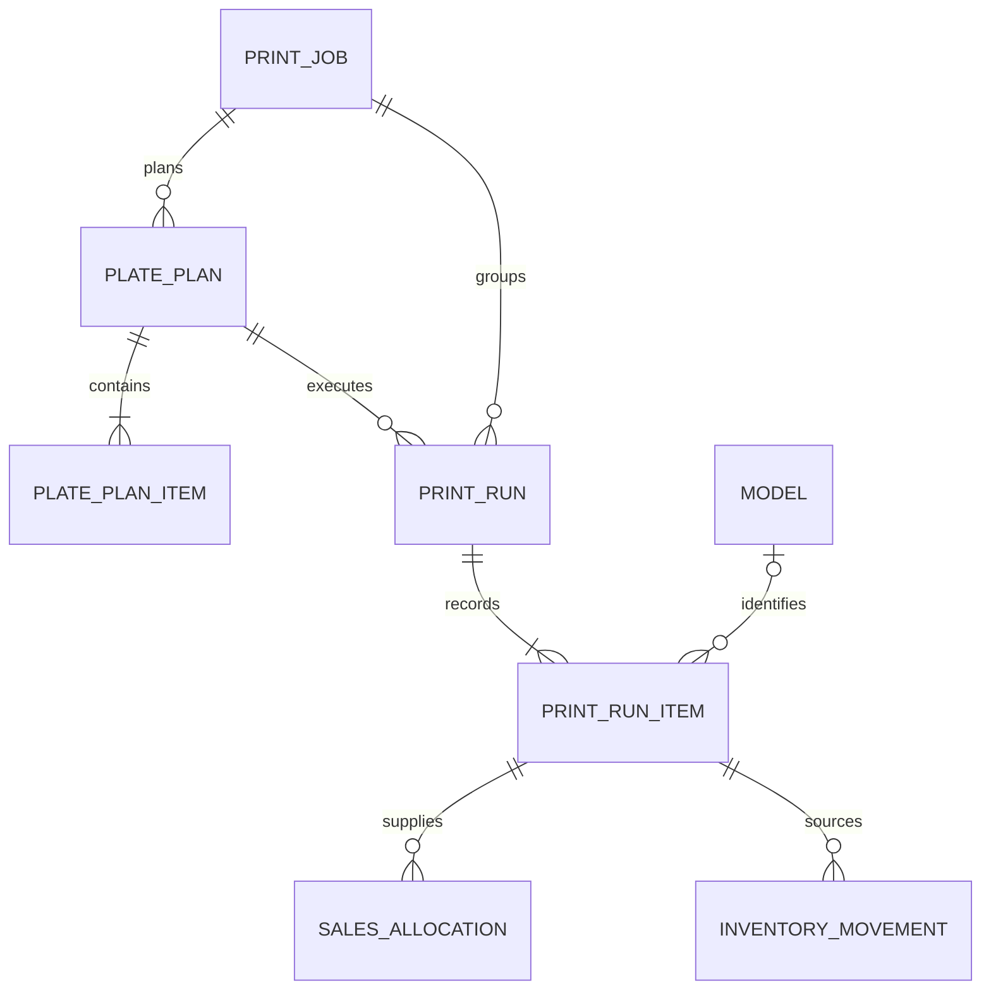

# INV-01: production plans, runs and output

Status: proposed contract for review in #9 and alignment in #19 (BUS-01).
Target: v1.1.0, jointly with Inventory #7 and Business Operations #8.
This document specifies future behavior; it does not add tables, routes or UI.
No production schema implementation is authorized by this specification alone.

[BUS-01](BUSINESS_V1_1.md) supplies the paired proposal for independent workflow
states, conserved mixed-model cost attribution, explicit legacy-order adoption,
versioned API compatibility and Inventory operations. Review both contracts
together before implementing persistence.

## Scope and dependency gate

Issue #9 has no prerequisite for architecture work (the GitHub native blocked-by
list was also empty when checked on 2026-11-17). #19 is open and explicitly
starts alongside #9; both require contract agreement before schema changes.
#10 implements material semantics, #11 atomic lifecycle, #12 the ledger,
#14 migration/backup integration and #16 finished goods. #23/#24 consume the
production contract; #26 integrates reservations after #16. None of those
implementations is included here. Record agreement on the contracts below in
the #9/#19 PRs before starting schema work. Both epics must pass joint release
qualification before v1.1.0 ships.

## Verified baseline

Reviewed against develop at `bd414e2`:

| Evidence | Current behavior / consequence |
| --- | --- |
| `apps/api/models/print_job.go` | One nullable ModelID, UnitsPrinted, date, total labor, optional duration and printer snapshot; no lifecycle, plates or quality counts. |
| `apps/api/models/model.go` | Reusable single-model weight/time defaults; not a plate layout or execution record. |
| `apps/api/models/print_job_filament.go` | Stable UUID rows with job/filament/WeightUsed (grams); no estimate/actual provenance or run reference. |
| `apps/web/src/pages/PrintJobs.jsx` | Defaults multiply model duration/weight by units. Saving a job and deleting/reinserting filament rows uses separate requests; a later failure can leave partial data. |
| `apps/api/handlers/print_job_handler.go` | Existing cost engine uses recorded material, total duration and labor with printer/config values; financial waste factor affects cost. |
| `apps/api/modules/sales/handlers/sales_allocation_service.go` | Allocates by job/model and UnitsPrinted, serializes capacity checks with SQLite writer lock, excludes cancelled orders; replacement recreates allocation rows. |
| `apps/api/modules/sales/handlers/sales_completion_service.go` | Freezes cost/profitability snapshots; current completion does not require full ordered quantity. |
| `apps/api/handlers/desktop_data_handler.go` | ZIP format 1, schema 4; explicit core-table copy lists and transactional restore, not automatic discovery of every table. |
| `apps/api/desktopruntime/server.go` | Shared SQLite initialization for desktop and standalone; UUIDs generated in Go hooks. |

Existing allocation, completion, deletion, cost and backup behavior must remain
covered. New production functionality cannot reinterpret legacy counts as
verified accepted goods or recalculate completed commercial snapshots.

## Candidate entities and ownership

Core owns all production entities, regardless of the `sales_orders` preference
or whether that module is installed. Inventory owns physical movements and
availability. Business owns demand, commercial allocation links and terms.

| Candidate | Required meaning |
| --- | --- |
| PrintJob | Existing stable parent ID and legacy fields retained; groups a production task. No order ownership. |
| PlatePlan | Stable ID, job ID, revision, label, repetitions (positive integer), per-plate estimated duration and per-filament estimated grams. Each layout has independent estimates. |
| PlatePlanItem | Stable ID, plan ID, nullable model ID plus name snapshot, positive units per plate. Unknown historical/ad-hoc identity must not match arbitrary catalog items. |
| PrintRun | Stable ID, job ID, optional plate-plan ID and frozen plan revision, repetition index, status, printer/cost snapshot, estimated and actual duration/labor separately, provenance and revision. Exactly one attempted plate execution, never a multiplier for executed output. |
| PrintRunItem | Stable ID, run ID, optional plan-item ID, model/name snapshot, planned units, attempted units, accepted units, rejected units; output verification marker. |
| Run material record (#10) | Stable ID, run ID, filament ID, estimated grams, recorded actual grams, included physical waste grams and provenance. Exact precision/storage belongs to #10/#12. |

New IDs use Go UUID hooks. Array position, name, date or model ID is never a
child identity. Updates patch existing IDs; reject IDs belonging to another
parent. New rows get new IDs, retries reuse the committed result. Referenced
items cannot be removed/recreated. A run snapshots its plan when started;
editing an unexecuted plan never rewrites prior runs. A retry after a failed
physical print is a new run ID, whereas a network retry is the same operation.
Keep existing PrintJobFilament IDs and job references during migration; do not
copy them into two independently counted sources.

## Quantity and estimate rules

For model m, planned units = sum over plates p of
`units_per_plate[p,m] × repetitions[p]`. Use checked integer arithmetic and
reject overflow, fractions, negative counts and zero repetitions/item counts.
Boundary values shared with JSON clients must be safe integers (at most
9,007,199,254,740,991); production APIs may impose smaller documented limits.

Example: plate A contains 2 brackets + 1 cap, repeated 3 times; plate B contains
1 bracket, repeated twice. Plan = 8 brackets + 3 caps across 5 executions.
A takes 60 minutes / 30 g per execution; B takes 25 minutes / 12 g.
Plan estimate = 230 minutes / 114 g, not model time multiplied by total units.
Changing B never scales A. A run may override estimates before start; measured
execution totals remain distinct and are never multiplied by repetitions.
Labor is a total per run, not a per-unit implicit multiplier.

Execution example: A1 accepts 2 brackets + 1 cap; A2 accepts 1 bracket and
rejects 1 bracket + 1 cap; A3 fails (rejects 2 brackets + 1 cap); B1 accepts
1 bracket; B2 is still planned. Accepted = 4 brackets + 1 cap; rejected =
3 brackets + 2 caps. Planned/unstarted B2 adds no accepted output or stock.

For each terminal run item, `accepted + rejected = attempted` and
`0 <= attempted <= planned`. Zero attempts are allowed for cancellation before
printing. In progress, `accepted + rejected <= attempted`; unclassified units
are pending inspection, never available. Only verified accepted output from a
completed run can supply new allocation or finished goods. A failed run has
zero accepted units, though it can consume material. Partial usable output
uses completed with explicit rejected counts, not failed. Actual zero is
distinct from unknown/null. Historic counts use unverified provenance.

Run lifecycle proposal for #11:

| From | Allowed next | Conditions |
| --- | --- | --- |
| planned | in_progress, cancelled | No output or actual consumption before execution. |
| in_progress | completed, failed, cancelled | Terminal counts reconcile; failed/cancelled have zero accepted; retain actual consumption even with zero output. |
| terminal | no direct reopen | Auditable correction/compensation, with downstream reference guards. Reprint creates a new run. |

Reject transitions that erase consumed material or allocated/fulfilled output.
A correction cannot reduce accepted units below committed use; shipped or
financially frozen history requires an explicit reversal workflow, not edits.

## Shared contract offered to BUS-01

These are logical service/DTO contracts, not currently registered endpoints.
Core must not import Sales storage. Extend existing module guards for run/item
references while retaining legacy Print Job deletion protection.

- `ProductionOutput`: job ID, run ID, run-item ID, model ID/name snapshot,
  revision, status, planned/attempted/accepted/rejected quantities,
  verification, cost state (`calculated`/`unavailable`), cost provenance and
  integer-cent cost when available. Unknown cost is not zero.
- Business planning links demand to plans without reserving physical goods.
  Progress reports required/planned/accepted/allocated/outstanding separately.
  Outstanding production is `max(0, required - accepted assigned to demand)`;
  completion needs sufficient accepted assigned units for every line (#24).
- New allocations reference run-item IDs and retain job IDs for traceability.
  Model identity must match; enforce line demand and output capacity under a
  single writer transaction across all active orders. Null model links require
  explicit identity resolution before new catalog allocation.
- Physical availability and reservation come solely from Inventory (#12/#16).
  A commercial allocation and its inventory reservation share one operation
  identity; they are not two deductions. Fulfilment converts/releases the
  reservation and records dispatch once. Planned supply is never physical stock.
- Cancellation releases unfulfilled reservations, retains historical links,
  and does not return already dispatched goods without a return movement.
- Core costs reuse `LoadProductionCostConfig` and
  `CalculateProductionPrintJobCostState` semantics via a run adapter in future
  implementation. Never reuse a job total once per run. Mixed-model run cost
  apportionment must be agreed in #19/#10 before implementation (explicit
  snapshotted shares, conserved rounded cents, no invented zero costs).
  Completed order/allocation snapshots remain authoritative and unchanged.
- Business enabled/disabled is presentation state, not permission to change
  production, erase reservations, or discard financial history.

## Atomic write and API compatibility contract

Keep current Print Job and filament paths/JSON fields for legacy single-model
records. Introduce a separately versioned aggregate write contract for plans,
runs, items and material rows in #11. Requests carry operation ID, expected
revision and stable child IDs. Same operation and same payload returns the
committed result; changed payload with reused operation ID conflicts. Stale
revisions, invalid state, capacity or ownership conflicts change nothing.
Validation errors identify fields; missing references return not found;
conflicts return 409. No raw SQL errors in user responses or private payloads
in diagnostics. Existing loopback/CORS/LAN authorization boundaries apply.

Acquire SQLite writer lock before reading revision/capacity. Validate parents,
model/filament identities, finite positive recorded material weights and all
counts, then persist aggregate, inventory effects and idempotency result in
one transaction. Failure at any stage rolls everything back. No asynchronous
best-effort stock write. Retries after an uncertain response retrieve the same
result. #11/#12 own failure injection and concurrency tests of real persistence.

For new multi-model jobs, legacy singular ModelID must remain null rather than
selecting an arbitrary model. A legacy projection must explicitly identify
unsupported multi-run structure; legacy mutation must return 409 rather than
flattening runs or deleting their material history. Adapt the UI and all stats,
reports, exports, cost and Sales readers before enabling these records.
The legacy `units_printed` meaning remains unchanged on old records; new
accepted/attempted totals require explicit fields. Agree exact versioned wire
paths/projections in #11 and #19. This is an intentional future write restriction
on richer records; no current API changes are made by #9.

## Historical data, migration, backups and rollback

No migration or backup/schema version bump in #9. Candidate migration after
contract agreement:

1. Back up the database. Add tables/nullable references and an explicit migration
   marker in one transaction; do not rely on table creation alone as completion.
2. Preserve every existing job/model/filament/allocation UUID, timestamp and
   financial snapshot. Map each historical job to one synthetic legacy run and
   one item with its original nullable model and UnitsPrinted as legacy reported
   output. Do not infer a number of plates, repetitions, rejects or verified
   accepted units. Expose legacy completed provenance separately from verified
   completion. Existing historical allocation capacity remains on its legacy
   path; no new stock or allocation capacity is minted from unverified output.
3. Uniquely key the legacy mapping by job ID and migration kind. Persist generated
   UUIDs once; repeated startup/import must reuse them. Existing material rows
   attach once to that legacy run with unknown measurement provenance. Preserve
   cost snapshots and null/explicit duration semantics. Invalid/orphaned source
   data aborts with diagnostics before target replacement; never silently drop it.
4. Existing Sales allocations retain IDs, job links and frozen cost cents. Add
   nullable run-item links only when unambiguous. No redistribution of completed
   profitability. #19 owns treatment of still-open legacy orders; do not
   retroactively invalidate completed orders for insufficient allocation.
5. Historical production and purchases do not create ledger entries by replay.
   Opening physical stock requires explicit reconciliation (#14). Mark it
   unverified until then. Reconciliation has its own operation ID so restoring
   or retrying cannot double seed stock.
6. Before enabling persistence, bump backup schema beyond 4 (coordinate the
   exact next version in #14), include new tables in validation, delete and
   restore lists, preserve dependency order and accept supported older archives
   through the same idempotent normalization. Restore core run items before
   Sales links and ledger references. Validate first, replace atomically.
   Whole-file export alone does not make explicit-list import safe.
7. Add a core compatibility/version gate so older builds cannot open a database
   they would misinterpret; coordinate module contract/version changes with
   #19. Reject unsupported newer archives before changing target data.

Rollback this architecture PR by reverting documentation/tests. Future data
rollback uses a pre-upgrade backup with a compatible binary; no destructive
reverse migration. Warn that restoring the older backup loses subsequent
writes. Desktop and self-hosted must run exactly the same migration/restore
path; no public hosting or extra database is introduced.

## Validation and handoff

`apps/api/architecture/production_contract_test.go` is a test-only executable
quantity specification: mixed plates, variable estimates, partial/failed
output, pending units, invalid counts and overflow. It is not runtime validation
or a simulated guarantee of database atomicity.

Existing automated evidence to retain/run:

| Requirement | Existing tests / next implementation coverage |
| --- | --- |
| Legacy quantities/cost inputs | `TestPrintJobLaborUnitsCostMatrix`, `TestPrintJobUnitsRejectNonPositiveValuesWithoutChangingData` |
| Allocation success/validation/rollback/concurrency | `TestSalesAllocationSupportsManyToManyAndAvailability`, `TestSalesAllocationRejectsCapacityAndModelConflicts`, `TestSalesAllocationReplacementRollsBackOnPersistenceFailure`, `TestSalesAllocationConcurrentRequestsCannotOverAllocate` |
| Frozen finances and atomic completion | `TestSalesCompletedProfitabilityIgnoresMutableProductionData`, `TestSalesCompletionSnapshotAndStatusAreAtomic` |
| Old backups and failure isolation | `TestSchemaTwoBackupPreservesProductionAndInitializesSalesEmpty`, `TestSalesBackupRejectsInvalidRelationshipsWithoutReplacingTarget` |
| Shared runtime/module independence | `TestInitDBSQLiteSeedsDefaultsAndSupportsUUIDInserts`, `TestProductionOnlyStartupAndPrimaryRoutes`, standalone server tests |
| Future migrations (#11/#14/#19) | Run twice; retain all UUIDs/snapshots; null-model history; restore old/new archives; reject newer versions; injected failure leaves original database intact. |
| Future lifecycle/ledger (#11/#12/#16) | Atomic aggregate rollback at every write, duplicate operation, conflicting retry, concurrent allocation/correction, failed consumption, no stock for plans, disabled Business, compensate once. |

Run `go test ./...`, `go vet ./...` in apps/api and frontend lint/test/build.
No UI changes or screenshot refresh in #9. Desktop Windows/Linux packaged
artifact and self-hosted end-to-end qualification remain mandatory for the
joint release; unit tests do not substitute for those checks.

The [BUS-01 handoff](BUSINESS_V1_1.md) addresses run-item identity/capacity,
cost apportionment, legacy open-order treatment, versioned DTO projections,
Inventory operation identity and migration/backup gates. These remain design
contracts until their implementation issues land. After #19 contract agreement,
#10 continues production and #20 starts the Business core; #12 follows #11,
not #9 directly.
