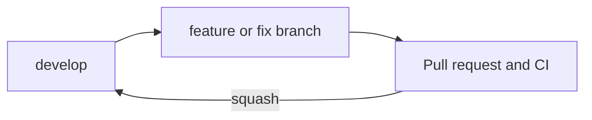
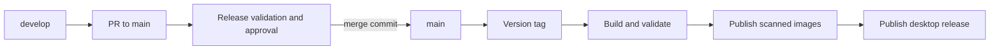

# Branching and releases

`develop` is the integration branch; `main` contains validated releases. Fork the
repository, branch from current `develop` as `feature/name` or `fix/name`, and
open a pull request to `develop`. Resolve review conversations and pass CI.
Maintainers squash merge contributions; neither permanent branch accepts direct
pushes. Delete temporary branches after integration when appropriate.

## Release

1. Agree on a version and finish release preparation on `develop`, including
   version metadata, changelog and qualification in [PUBLIC_RELEASE](../PUBLIC_RELEASE.md).
2. Open a PR from this repository's `develop` to `main`. Resolve conversations,
   update it against `main`, and verify all required checks. The release gate
   requires preflight, browser and visual tests, Windows installer and archive
   smoke tests, Linux archive smoke tests, and native self-hosted AMD64 and ARM64
   image scans and smoke tests. Complete manual qualification in PUBLIC_RELEASE.
3. A maintainer approves the version for publication and merges with a **merge
   commit**, preserving ancestry. Fetch `main`, verify the merge commit and its
   checks, and create an annotated `vMAJOR.MINOR.PATCH` tag on that commit;
   prerelease suffixes are supported. Push the tag only after authorization.
4. Monitor Desktop CI and Release. It builds artifacts from the tagged commit,
   scans and publishes the same self-hosted image archives, then publishes the
   GitHub release. Verify checksums, Windows installer and archive, Linux archive,
   image manifest and immutable digest, and qualification evidence. See
   [self-hosted qualification](../SELF_HOSTED.md) for physical LAN and upgrade
   checks; automated smoke tests without a baseline do not prove upgrade/rollback.

If publication fails, inspect the failed run and existing release and registry
assets before retrying. Rerun failed jobs only when their inputs and retained
artifacts remain valid. If an image or release is partially published, record
its digest and communicate its status; do not move or reuse a published tag.
Correct the cause through the normal PR process and publish a new version.
Retain prior artifacts and backups for rollback; follow SELF_HOSTED for data
rollback. Restrict tag creation and deletion to trusted maintainers: tag-based
workflows execute the workflow definition in the tagged commit, so ancestry
checks alone cannot prevent a malicious tagger from altering that workflow.

## Urgent fixes

The strict source rule means an urgent fix must enter `develop` first and the
whole integration branch must pass release validation. If it contains unreleased
features, delay the hotfix or revert those features through reviewed PRs before
promotion. This is an explicit speed trade-off. A narrowly controlled release
branch or exceptional administrative procedure would require a separate policy
and ruleset change; there is no silent bypass.

## Ruleset activation checklist

Do not require new contexts before their workflows exist on the target branch.
First merge the workflow to `develop`, promote it to `main` under the existing
rules, and run a fresh test PR to `main`. Confirm the source check appears for
same-repository and fork PRs and that the release gate executes. Then an
administrator should configure GitHub Actions as the source for each context:

- **develop**: active, target `develop`, restrict deletion and force pushes,
  require PRs, zero approvals, resolve conversations, linear history, squash
  only; retain existing required preflight and LAN checks.
- **main**: active, target default branch, restrict deletion and force pushes,
  require PRs, zero approvals, resolve conversations, disable linear history,
  permit merge commits, require branch up to date. Require existing preflight,
  dependency, LAN and visual contexts plus `Release validation gate` and
  `Only develop can merge to main`. Verify exact displayed context names from
  actual runs. Remove squash as an allowed method for this branch.
- Restrict release tag creation, update and deletion to trusted maintainers.
  Repository-wide merge methods must allow both squash and merge commits.

A skipped job can report success as a required check; the release gate itself
runs unconditionally on main PRs and rejects any non-success dependency. A
workflow missing on the base branch cannot provide the trusted source check;
complete the rollout above before relying on it. GitHub settings are not changed
by this document.
